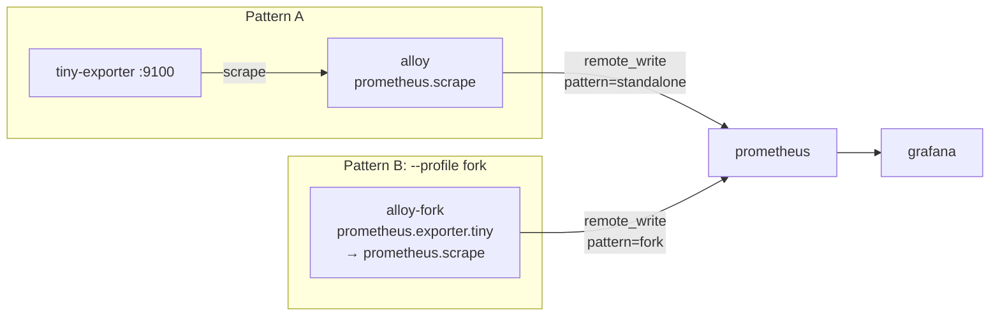

# Alloy Playground

Prometheus Exporter の代わりに [Grafana Alloy](https://github.com/grafana/alloy) で独自メトリクスを扱う 2 パターンを比較するサンプル集です。
どちらも `/proc/loadavg` を `tiny_load_average{period="1m|5m|15m"}` として出す同じ collector を使います。

## フォルダ

| フォルダ | 内容 |
|---|---|
| [`standalone-exporter`](./standalone-exporter) | Pattern A。Go で書いた独立 exporter。公式 Alloy の `prometheus.scrape` で scrape する |
| [`alloy-fork`](./alloy-fork) | Pattern B。Alloy v1.21.1 のソースに `prometheus.exporter.tiny` component を追加してビルドする |
| [`config`](./config) | Alloy / Grafana の設定 |

## 構成



Prometheus は `--web.enable-remote-write-receiver` で起動し、Alloy から remote_write で受け取ります。

## 使い方

Pattern A のみ:

```sh
docker compose up -d --build
```

Pattern A + B (alloy-fork は Alloy 本体をソースからビルドするため初回は時間がかかります):

```sh
docker compose --profile fork up -d --build
```

| URL | 内容 |
|---|---|
| http://127.0.0.1:3000 | Grafana (admin / admin)。Explore で `tiny_load_average` を検索 |
| http://127.0.0.1:9090 | Prometheus |
| http://127.0.0.1:12345 | Alloy (Pattern A) の UI |
| http://127.0.0.1:12346 | Alloy (Pattern B)。UI はビルドしていないため API のみ |

Pattern B の component 単体のメトリクスは Alloy の HTTP server から取れます:

```sh
curl -s http://127.0.0.1:12346/api/v0/component/prometheus.exporter.tiny.host/metrics | grep tiny_
```

## Pattern B の仕組み

Alloy にはプラグイン機構が無く、component は Go の `init()` で `component.Register` されたものだけが使えます。
exporter 系 component は `internal/` 配下の API (`exporter.New`, `integrations.NewCollectorIntegration`) を使うため、Go の internal ルールにより外部モジュールからは import できません。そのため Alloy のソースツリーにファイルを追加してビルドします。

[`alloy-fork/Dockerfile`](./alloy-fork/Dockerfile) は次を行います:

1. `grafana/alloy` の `v1.21.1` を clone
2. `tiny/` を `internal/component/prometheus/exporter/tiny/` にコピー
3. `all_tiny.go` を `internal/component/all/tiny.go` にコピー (blank import で component を登録)
4. `collector/` (main パッケージ) で `go build`

`prometheus.exporter.tiny` は `featuregate.StabilityExperimental` で登録しているため `--stability.level=experimental` が必要です。

ローカルで test する場合:

```sh
git clone --depth 1 --branch v1.21.1 https://github.com/grafana/alloy.git
cp -r alloy-fork/tiny alloy/internal/component/prometheus/exporter/tiny
cp alloy-fork/all_tiny.go alloy/internal/component/all/tiny.go
cd alloy && go test ./internal/component/prometheus/exporter/tiny/
```

## 比較

| | Pattern A: 独立 exporter + `prometheus.scrape` | Pattern B: Alloy を fork して component 追加 |
|---|---|---|
| Alloy 本体 | 公式イメージをそのまま使える。upgrade はタグを上げるだけ | 自前ビルド。upgrade ごとに upstream へ追従し再ビルドが必要 |
| 依存する API | `client_golang` の公開 API のみ | Alloy の `internal/` API。リリース間で互換性の保証が無い |
| ビルド (実測) | 依存 module 33 個、バイナリ 14MB | Alloy 全体のビルドが必要。依存 module 2043 個、バイナリ 536MB |
| プロセス / ネットワーク | exporter のプロセスとポートが増える。exporter 側の公開範囲・認証を管理する必要がある | 単一バイナリ。追加ポート不要 (Alloy の HTTP server 経由) |
| 設定 | exporter の flag / env と Alloy 設定が分かれる | Alloy 設定の `Arguments` で渡せ、他 component の出力を式で参照できる |
| 再利用性 | Prometheus 単体や他のエージェントからも scrape できる | Alloy 専用 |
| 可観測性 | exporter の状態は `up` メトリクスで見る | Alloy UI / health に component として出る |
| 脆弱性対応 | Grafana の公式リリースに任せられる | 自分で再ビルドして配布する |

判断の目安:

- 自分のサービス向けの独自メトリクスなら Pattern A。運用コストが低い
- 既存 exporter を Alloy に統合したい、upstream に contribute したいなら Pattern B。Alloy 本体の `prometheus.exporter.*` もこの形で既存 exporter の collector をラップしている (例: `internal/static/integrations/dnsmasq_exporter`)
